<p align="center">
  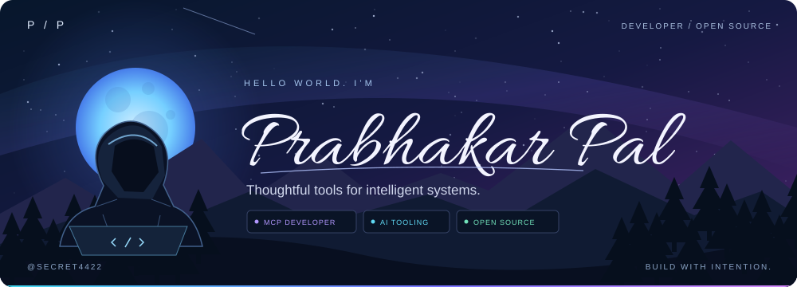
</p>

<p align="center">
  <strong>Autonomous AI Agents · Developer Platforms · Zero-Friction Tooling</strong><br />
  I’m Prabhakar — Founder &amp; Lead Architect at AlphaTech Studio. Building high-moat open-source infrastructure for developers building with AI.
</p>

<p align="center">
  <a href="#the-person-behind-the-code">About me</a> ·
  <a href="#flagship-platforms">Flagship Platforms</a> ·
  <a href="#quick-launch">Quick Launch</a> ·
  <a href="#open-source-toolbox">Toolbox</a> ·
  <a href="https://orcid.org/0009-0004-1069-156X">ORCID ↗</a>
</p>


<sub>Public GitHub data · Snapshot: 29 October 2026 · All metrics and charts below are static, not live counters.</sub>

<a id="the-person-behind-the-code"></a>

## The person behind the code

<table>
  <tr>
    <td width="50%">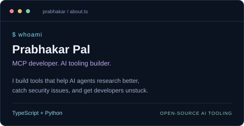</td>
    <td width="50%">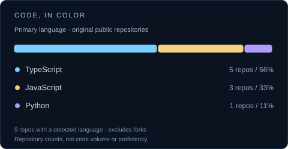</td>
  </tr>
</table>

## A little progress, every day

<a href="https://github.com/SECRET4422?tab=overview">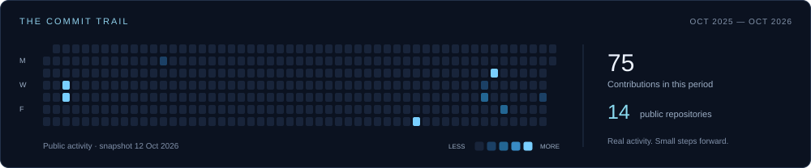</a>

## The tools & the direction

<table>
  <tr>
    <td width="50%">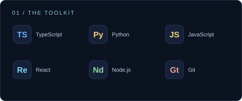</td>
    <td width="50%">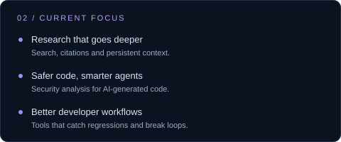</td>
  </tr>
</table>

<a id="flagship-platforms"></a>

## Flagship Platforms &amp; Developer Tools

Mission-critical open-source tooling for modern AI agent engineering. **Select any card to explore its repository.**

<table>
  <tr>
    <td width="50%"><a href="https://github.com/SECRET4422/agent-cockpit">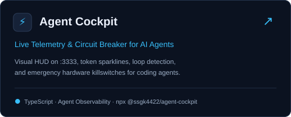</a></td>
    <td width="50%"><a href="https://github.com/SECRET4422/vision-craft">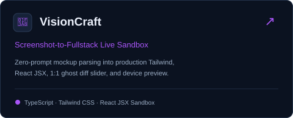</a></td>
  </tr>
  <tr>
    <td width="50%"><a href="https://github.com/SECRET4422/visual-smoke">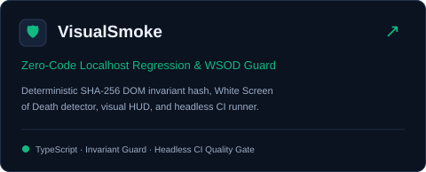</a></td>
    <td width="50%"><a href="https://github.com/SECRET4422/loopbreaker">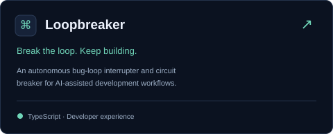</a></td>
  </tr>
  <tr>
    <td width="50%"><a href="https://github.com/SECRET4422/mcp-deep-research-server">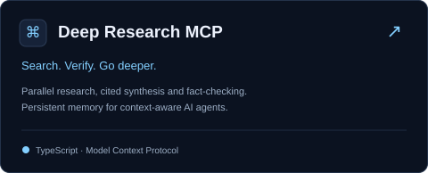</a></td>
    <td width="50%"><a href="https://github.com/SECRET4422/guardrail-mcp">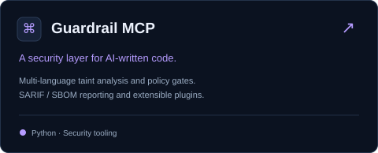</a></td>
  </tr>
  <tr>
    <td colspan="2" align="center"><a href="https://github.com/SECRET4422/autosmoke">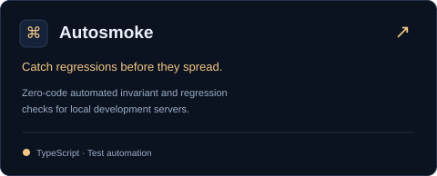</a></td>
  </tr>
</table>

<a id="quick-launch"></a>

### ⚡ Quick Launch (Zero Install)

Run any tool directly in your terminal without manual cloning:

```bash
# Real-time visual telemetry HUD for AI coding agents (port 3333)
npx @ssgk4422/agent-cockpit

# Screenshot-to-fullstack UI sandbox with 1:1 ghost diffs (port 5050)
npx vision-craft

# Zero-code localhost regression guard & WSOD detector (port 4040)
npx visual-smoke --ci http://localhost:3000
```

<br />

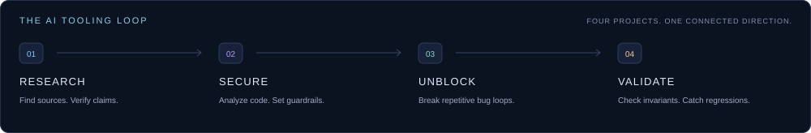

<a id="open-source-toolbox"></a>

## Open-source toolbox

Useful places to explore, learn, and contribute.

<table>
  <tr>
    <td width="25%"><a href="https://github.com/SECRET4422?tab=repositories">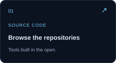</a></td>
    <td width="25%"><a href="https://modelcontextprotocol.io/docs/getting-started/intro">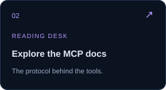</a></td>
    <td width="25%"><a href="https://github.com/SECRET4422/mcp-deep-research-server/issues">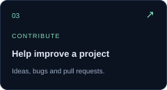</a></td>
    <td width="25%"><a href="https://orcid.org/0009-0004-1069-156X"></a></td>
  </tr>
</table>

<details>
<summary><strong>Have an idea? Here’s a good place to start.</strong></summary>

<p>If you’re working on autonomous agents, code security, or developer tooling, take a look at the projects above. Open an issue in the relevant repository with the problem you’re trying to solve, an example, and what a useful result would look like. Small fixes and thoughtful bug reports are welcome too.</p>

</details>

<br />

<a href="https://github.com/SECRET4422?tab=repositories"></a>
